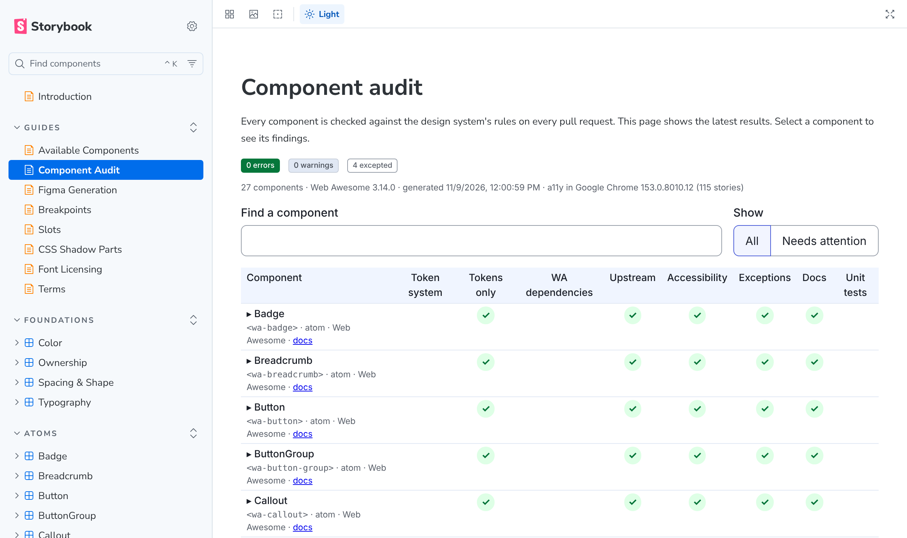
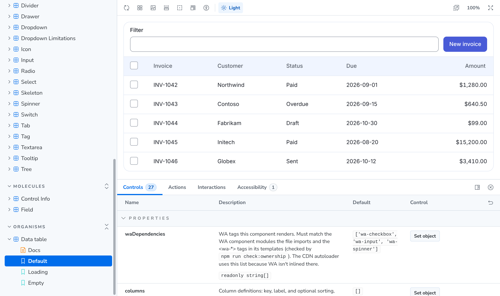

# Soar Awesome

A design-system proposal I built to show how a team can run a design system on top of an open-source component library without forking it. **Soar is a fictional brand.**

**[Live Storybook](https://wedwu.github.io/soar-design-system/)** · **[Vue Storybook, loaded from the CDN build](https://wedwu.github.io/soar-design-system/vue/)**



## What it shows

- **Re-theming, not forking.** [Web Awesome](https://webawesome.com) 3.14.0 supplies accessible Web Components; Soar owns only the look and the larger patterns. An ownership audit enforces which CSS properties Soar may set and which it inherits.
- **Figma as the token authority.** Figma variables are pulled into `packages/tokens/figma/export.json`, mapped through an alias map to Web Awesome's CSS custom properties, and generated into the theme. CI fails on any hand edit to generated CSS.
- **Upstream safety.** A snapshot of the installed Web Awesome is checked in CI, and `upstream:bump` shows exactly what changes when Web Awesome is upgraded.
- **A component audit on every pull request.** 27 components checked for token use, Web Awesome dependencies, upstream drift, accessibility (axe on every story in Chrome), documented exceptions, docs and unit tests. The results render as a page in Storybook.
- **Molecules and organisms built with Lit.** A validated field, a control-info pattern and a filterable, selectable data table, all on a shared base class.
- **One build, any framework.** Shipped as an npm tarball and a single-file CDN bundle, with working samples for Angular, React, Vue and plain HTML, plus a Vue Storybook that loads everything from the CDN tree exactly as an app would.
- **Release discipline.** Changesets for versioning, a CDN staging step with SRI hashes, and a guard that blocks publishing to any public registry.



The rest of this README is the full handbook for the repo: every tool, package and workflow, and how to do common tasks. In this public copy the Figma sync and release workflows only run by hand, since there is no Figma file or static host connected.

**Contributing?** Read [docs/CODING_STANDARDS.md](docs/CODING_STANDARDS.md) first. It has the rules, what enforces each one, and a review checklist.

This README explains every part of the repo: what each tool is, why it's here, how the pieces connect, and how to do common tasks. The ownership rules (what we own versus inherit from Web Awesome) are covered in depth in [docs/ARCHITECTURE.md](docs/ARCHITECTURE.md).

**Contents**

1. [Quick start](#1-quick-start)
2. [The big picture](#2-the-big-picture)
3. [Repository map](#3-repository-map)
4. [The toolchain, explained](#4-the-toolchain-explained)
5. [The packages, explained](#5-the-packages-explained)
6. [Tools, explained](#6-tools-explained)
7. [Storybook and samples](#7-storybook-and-samples)
8. [CI, releases and automation](#8-ci-releases-and-automation)
9. [How-to guides](#9-how-to-guides)
10. [Consuming the design system](#10-consuming-the-design-system)
11. [How this repo was built, step by step](#11-how-this-repo-was-built-step-by-step)
12. [Command reference](#12-command-reference)
13. [Notes and known limits](#13-notes-and-known-limits)

---

## 1. Quick start

You need **Node 22+** and the npm that comes with it. Nothing else needs to be installed globally.

```bash
npm install          # installs every workspace package and links them together
npm run build        # builds tokens → theme → components → cdn, in order
npm test             # token tests + component unit tests
npm run storybook    # docs site at http://localhost:6006
```

Run commands from the **repo root**. That's where the scripts in §12 are defined. Arguments for a script go after `--`, for example `npm run audit:components -- --require a11y`.

**Windows:** Windows PowerShell 5.1, the version built into Windows, doesn't support `&&` between commands. The docs never ask you to type it: every multi-step task is a single script, such as `npm run audit:full` and `npm run verify`, or the steps are listed one per line. Scripts that use `&&` internally work everywhere, because npm runs them through `cmd.exe` on Windows.

---

## 2. The big picture

```
                   ┌─────────────────────────────── decisions we own ───────────────────────────────┐
 Figma variables ─▶│ tokens: normalize → --ax-* CSS   +   alias-map: --wa-* = var(--ax-*)            │
 (source of truth) │ theme:  generated CSS + parts.css (hand-written ::part fixes) in cascade layers │──▶ npm: @soar-awesome/theme
                   └──────────────────────────────────────────────────────────────────────────────────┘
 Web Awesome ─────▶ atoms (wa-button, wa-drawer, ...) used as-is, never forked ───────────────────────▶ apps import from WA
                     ▲
                     │ composed by
 components ───────▶ molecules + organisms (ax-field, ax-data-table) ────────────────────────────────▶ npm: @soar-awesome/components
                     │
 cdn ──────────────▶ one minified file of all ax-* + autoloader (WA NOT inlined) ──────────────────▶ self-hosted CDN
                     │
 storybook ────────▶ documents foundations, atoms, molecules, organisms in one place
```

Three rules hold the system together:

1. **Figma is the only source of visual values.** No hand-written hex codes, px or rem values anywhere. `npm run check:ownership` enforces this.
2. **Web Awesome is never forked or patched.** We restyle it through its own `--wa-*` CSS custom properties. When no property exists for a change, we use a `::part()` rule.
3. **Every value has exactly one writer**, so Figma syncs and Web Awesome upgrades can't silently overwrite each other's changes or ours.

---

## 3. Repository map

```
soar-awesome/
├── package.json              workspaces, root scripts (§12) and the Web Awesome override; private, never published
├── package-lock.json         exact resolved versions; always commit it
├── turbo.json                task graph + caching rules for Turborepo
├── tsconfig.base.json        shared TypeScript settings
├── renovate.json             automated dependency PRs (WA bumps need human intake)
├── AGENTS.md                 written by Turborepo for AI coding agents; keep it committed
├── .changeset/               release notes + version bumps (Changesets)
├── .github/
│   ├── workflows/            ci.yml, release.yml, figma-sync.yml
│   └── CODEOWNERS            who must review ownership/release changes
├── docs/ARCHITECTURE.md      ownership model in depth
│
├── packages/                 all private; apps install only soar/, as a tarball (§10)
│   ├── soar/               THE package apps install: bundles theme + components + tokens
│   ├── tokens/               Figma export → tokens (CSS, JS, SCSS, DTCG)
│   ├── theme/                atoms: Web Awesome retokenized; stylesheets only
│   ├── components/           molecules + organisms (Lit custom elements)
│   └── cdn/                  single-file bundle + autoloader
│
├── apps/storybook/           the documentation site (not published)
├── samples/                  React / Vue / Angular / plain HTML integration demos
└── tools/                    repo scripts: figma-sync, upstream-bump, release, shared CSS reader
```

**Generated vs. hand-written.** Knowing which files you may edit matters more than anything else here:

| Hand-written (edit these) | Generated (never edit; CI fails if you do) |
|---|---|
| `packages/tokens/src/alias-map.mjs`, `inherited.json` | `packages/tokens/figma/export.json` (written by `figma:pull`) |
| `packages/theme/src/parts.css`, `soar.css` | `packages/theme/src/{tokens,light,dark,webawesome}.css` |
| `packages/components/src/**` | `packages/tokens/upstream/*.json` (written by `upstream:bump`) |
| stories, samples, tools | everything in `build/`, `dist/`, `storybook-static/`, `cdn-release/` |

---

## 4. The toolchain, explained

### 4.1 npm: package manager and workspaces

[npm](https://docs.npmjs.com), which ships with Node, installs dependencies and links our packages together using **workspaces**.

- **Workspaces.** `"workspaces"` in the root `package.json` lists the folders that are packages: `packages/*`, `apps/*` and `samples/*`. One `npm install` at the root installs all of them, and links each `@soar-awesome/*` package into `node_modules` as a symlink to its folder, so edits take effect immediately.
- **Depending on a sibling package.** Inside the repo, `"*"` is satisfied by the local workspace copy. Apps never install `theme`, `components` or `tokens` separately: `@soar-awesome/soar` carries their built files, so it has no `@soar-awesome/*` dependencies at all.
- **The Web Awesome pin.** npm has no single place to declare a shared version, so the exact version (`3.14.0`) is written in each package that uses Web Awesome. Root `"overrides"` forces any transitive copy to the same version. `npm run upstream:check` fails if any of those pins disagree or use a range, and `npm run upstream:bump -- --to <version>` rewrites them all together (`tools/upstream-bump/wa-pin.mjs`).
- **Pinned npm version.** `packageManager` in the root `package.json` (`npm@10.9.3`) records the version the lockfile was made with. Turborepo reads it.
- **Lockfile.** `package-lock.json` holds the exact resolved versions. Always commit it. `npm ci`, which CI runs, installs exactly what it says and fails instead of changing it.
- **Never published.** Every package has `"private": true`, so `npm publish` refuses, and there is no `.npmrc` registry setting. `npm run check:private` (CI) fails if that changes. Apps install the `@soar-awesome/soar` tarball from our own host instead (§10).
- **Hoisting.** npm installs most packages at the root `node_modules`, so code can import a dependency it never declared without an error. Declare everything you import in that package's own `package.json`. The build won't catch it for you, but consumers' installs will break.
- **Useful forms:**
  - `npm run <script> -w <package>` runs a script in one package, e.g. `npm run dev -w @soar-awesome/storybook`.
  - `npm run <script> --workspaces --if-present` runs it in every package that has it.
  - `npm install <dep> -w <package>` adds a dependency to one package.

### 4.2 Turborepo: task runner and cache

[Turborepo](https://turbo.build) (`turbo`) runs scripts across the workspace in the right order and caches their results. Configuration lives in `turbo.json`.

- **Tasks.** `build`, `test` and `dev` are defined. Running `turbo run build` calls the `build` script in every package that has one.
- **`dependsOn: ["^build"]`.** The `^` means "the same task in my dependencies first". Turbo reads each `package.json` to build the dependency graph, so `npm run build` runs:

  ```
  tokens:build ─▶ theme:build ─▶ components:build ─▶ cdn:build
  ```

  Independent packages run in parallel.
- **Caching.** Turbo hashes a task's inputs: by default every git-tracked file in the package, plus its dependencies' hashes. If nothing changed, it restores the files listed in `outputs` (`dist/**`, `build/**`, `storybook-static/**`) and replays the logs instead of rebuilding. The output shows `cache hit, replaying logs`. The cache lives in `.turbo/` (gitignored). Remote caching can be enabled later to share it across CI and developers.
- **Filters.** The root `build` script uses `--filter=./packages/*`, so it builds only the library packages. `build:all` adds `./apps/*` to include Storybook. Samples are built on demand.
- **`dev`.** Marked `persistent` (long-running) and `cache: false`.
- **Environment variables.** Turbo's default *strict mode* hides environment variables from tasks unless they're listed under `env` in `turbo.json`. None of our build tasks read environment variables. If one ever does, add it to `env`, or it won't be visible and won't affect the cache key.
- **`AGENTS.md`.** Turbo writes this file for AI coding agents. It says to read the docs bundled at `node_modules/turbo/docs` before changing Turbo config. Leave it committed.

### 4.3 TypeScript

`tsconfig.base.json` holds shared settings. Each package extends it. Notable choices:

- `"useDefineForClassFields": false`. Lit's reactive properties are accessors on the prototype. With standard class-field semantics, a field like `label = ''` would *shadow* the accessor and break reactivity. This setting makes TypeScript and esbuild emit plain assignments instead.
- `moduleResolution: "Bundler"` and `verbatimModuleSyntax`. Modern ESM resolution that matches how esbuild and Vite resolve imports. Type-only imports must say `import type`.
- `tsc` only **emits type declarations** (`.d.ts`) for the components package. esbuild produces the JavaScript.

### 4.4 Lit and custom elements

Components are **custom elements** (Web Components), built with [Lit](https://lit.dev), the same library Web Awesome uses, so it's shared rather than duplicated. Custom elements work in any framework or none, which is how we stay framework-agnostic. Lit adds reactive properties, efficient templating and scoped styles via shadow DOM.

### 4.5 esbuild

[esbuild](https://esbuild.github.io) bundles JavaScript. It's used twice:

- **npm build** (`packages/components/build.mjs`):
  - One entry point per component, plus `index.ts`.
  - `splitting: true` moves shared code into `dist/chunks/`.
  - `lit` and Web Awesome are marked **external**, so the consuming app's bundler dedupes them against its own copies.
- **CDN build** (`packages/cdn/build.mjs`):
  - One minified ESM file with Lit inlined and Web Awesome *not* inlined.
  - A custom plugin turns Web Awesome component imports into no-ops and fails the build on any other Web Awesome import (see §5.4).

### 4.6 Custom Elements Manifest

`@custom-elements-manifest/analyzer` (`cem analyze --litelement`) reads component source and JSDoc tags (`@tag`, `@csspart`, `@event`, `@slot`, `@cssproperty`) and writes `custom-elements.json`, a standard machine-readable description of every element. Storybook uses it to generate controls and docs tables. IDEs and other tools can use it too.

### 4.7 Testing: Vitest, happy-dom and node:test

- **Component unit tests** (`*.test.ts`) run in [Vitest](https://vitest.dev) with **happy-dom**, a fast simulated browser DOM. `vitest.config.ts` swaps every Web Awesome import for a stub, so the tests exercise *our* logic (sorting, validation, events, form association) without depending on Web Awesome's rendering.
- **Token tests** (`packages/tokens/test/*.test.mjs`) use Node's built-in `node:test` (no dependencies). They cover:
  - the Figma and upstream diff rules (renames are blocking, new properties must be classified, and so on)
  - WCAG AA color contrast of what users **actually see**. `src/effective.mjs` resolves each `--wa-*` color the way the browser does: owned properties through Figma, inherited ones through Web Awesome's defaults. It checks text on every variant fill (loud, normal, quiet) and on surfaces, in light and dark.
  - each color ramp getting darker step by step
- **Real-browser coverage** comes from Storybook play functions (see `Molecules/Field → In A Form`) and the accessibility addon.

### 4.8 Storybook

[Storybook](https://storybook.js.org) 10 with the `web-components-vite` framework (Vite is the dev server and bundler) is the single documentation site. Details are in §7.

### 4.9 Changesets

[Changesets](https://github.com/changesets/changesets) manages versions and changelogs. Each PR that changes a library package adds a small markdown file via `npm run changeset`, which names the packages and the bump type (patch, minor or major). On release, those files become version bumps and CHANGELOG entries.

The five library packages are a **fixed group** (`.changeset/config.json`), so they always share one version number. They're all `private`, so `"privatePackages": { "version": true }` tells Changesets to version them anyway; nothing is published. Guidance for bump types is in `.changeset/README.md`.

### 4.10 Renovate

[Renovate](https://docs.renovatebot.com) opens PRs to update dependencies (`renovate.json`).
- Web Awesome is special-cased: pinned, never auto-merged, and labeled `needs-decision`, because upgrades need the intake process in §9.5.

### 4.11 GitHub Actions

These three workflows are explained in §8.

---

## 5. The packages, explained

### 5.1 `@soar-awesome/tokens`: Figma → tokens

| File | Role |
|---|---|
| `src/canonicalize.mjs` | Sorts keys and drops volatile fields from a Figma payload, so a sync with no design change has no diff. Used by `pull.mjs` and the Storybook workbench. |
| `figma/export.json` | Raw Figma Variables payload. **Machine-written** by `npm run figma:pull` with sorted keys, so diffs only show real changes. Committed. |
| `src/normalize.mjs` | Turns the Figma payload into a flat token list. Rules: names become CSS variables (`color/brand/50` → `--ax-color-brand-50`); modes become `light`, `dark` or `base`; colors become hex; unitless Figma numbers get units by name and scope (space and radius → rem, durations → ms, weights unitless); aliases stay as `var(--ax-…)` so the chain is visible. |
| `src/alias-map.mjs` | **The ownership contract.** Maps each Web Awesome property we *own* to the Figma variable that drives it, e.g. `'--wa-color-brand-fill-loud': 'color/brand/fill-loud'`. |
| | It also lists **app-facing** tokens (`appFacing`, currently `breakpoint/*`): tokens that apps use directly rather than through Web Awesome, so the audit doesn't flag them as unused. |
| `src/inherited.json` | Web Awesome properties where we deliberately keep WA's default. Every upstream property must be owned *or* inherited. |
| `src/classify.mjs` | Answers "owned, inherited or unclassified?" for any property. |
| `src/build.mjs` | Writes `build/`: `tokens.css` (primitives and the layer order), `light.css` and `dark.css` (semantic values per mode), `webawesome.css` (`--wa-*: var(--ax-*)` for owned properties), `tokens.json`, `tokens.dtcg.json` (W3C Design Tokens format), typed `tokens.js` and `tokens.d.ts`, `_tokens.scss`, breakpoints as `breakpoints.css` (`@custom-media`), `_breakpoints.scss` (map + `ax-up()` mixin) and `breakpoints`/`media` exports in `tokens.js` (raw values, because `@media` can't read `var()`), and `figma/code-syntax.json` (pushes our CSS names back into Figma Dev Mode). |
| `src/diff.mjs` | Change reports for Figma syncs and Web Awesome upgrades, used by the tools in §6. |
| `upstream/*.json` | Snapshot of Web Awesome's properties, parts and layers at the last reviewed upgrade. |

**Cascade layers.** A cascade layer is a named CSS bucket. Rules in later layers win over earlier ones regardless of selector specificity. `tokens.css` declares Web Awesome's eight layers followed by ours:

```
wa-native, wa-base, …, wa-theme, wa-theme-dimension, wa-theme-overrides, ax-tokens, ax-theme, ax-parts
```

Our values therefore beat Web Awesome's defaults without `!important`. An app's own *unlayered* CSS still beats everything, which gives app teams an escape hatch.

### 5.2 `@soar-awesome/theme`: the atoms layer

Stylesheets only. Atoms are Web Awesome's components, and this package changes how they look.

| File | Role |
|---|---|
| `src/tokens.css`, `light.css`, `dark.css`, `webawesome.css` | Copied from tokens `build/` by `scripts/generate.mjs`. **Committed on purpose**, so a Figma change shows up as a CSS diff in the PR. `npm run tokens:check` regenerates them and fails if they differ. |
| `src/parts.css` | **Hand-written** fixes that Web Awesome's tokens can't express. It may set a component's own CSS properties (e.g. `wa-drawer { --size }`) or `::part()` styles, using `var(--ax-*)` or `var(--wa-*)` values only. All rules sit in `@layer ax-parts`. |
| `src/soar.css` | Entry file that `@import`s the five files above. |
| `scripts/build.mjs` | Copies `src/` to `dist/` and inlines the imports into one `dist/soar.css`. |

Dark mode reuses Web Awesome's classes, `.wa-dark`, `.wa-light` and `.wa-invert`. The generated CSS targets the same selectors Web Awesome does, which is necessary because Web Awesome sets colors directly on `.wa-dark` elements.

### 5.3 `@soar-awesome/components`: molecules and organisms

- `src/internal/ax-element.ts`: `AxElement`, the Lit base class.
  - Shared host styles, plus an `emit()` helper for `ax-*` events.
  - `static waDependencies` lists the Web Awesome tags the component renders. The audit checks this list matches the component's imports and templates, and the CDN uses it.
  - We **compose** Web Awesome elements (render `<wa-input>` inside ours). We never subclass them, because their classes aren't a public API.
- `src/molecules/ax-field/`: a text field built on `<wa-input>`. It shows errors after the user leaves the field, has a character counter, and is **form-associated** through `ElementInternals`. A `wa-input` inside our shadow root would otherwise be invisible to the page's `<form>`.
- `src/molecules/ax-control-info/`: a label and help text ("info") for any form control, shown inline or behind an info button, in a vertical or horizontal (settings-row) layout. It keeps the label, info and control in the page's DOM and wires them together. For Web Awesome controls, the text goes through the control's own `label`/`hint` API, because an outside label can't reach the input inside WA's shadow DOM. `parts.css` then hides WA's copy. The tag lists in `ax-control-info.ts` and the `parts.css` rules are kept in sync by a unit test.
- `src/organisms/ax-data-table/`: a table with filtering, sorting and row selection, built from `wa-input`, `wa-checkbox` and `wa-spinner`.
- Each component folder holds `name.ts` (logic and template), `name.styles.ts` (CSS using tokens only) and `name.test.ts`.
- `package.json` `exports` give each component its own import path (`@soar-awesome/components/ax-field.js`, which apps import as `@soar-awesome/soar/components/ax-field.js`), so apps only ship what they use. The build fails if a component is missing from `exports`.

### 5.4 `@soar-awesome/cdn`: single-file bundle

- `src/index.ts` registers every Soar component and starts the autoloader.
- `src/autoloader.ts` solves one problem: Web Awesome's own loader watches the page for `<wa-*>` tags, but our components render `<wa-*>` *inside shadow roots*, where it can't see them. When an `<ax-*>` element appears, the autoloader adds a hidden `<div data-wa-preload="wa-input …">`, a documented Web Awesome feature, so Web Awesome loads exactly the components needed. If they still aren't registered after 5 seconds, it logs a warning.
- **Web Awesome is not inlined.** Pages load Web Awesome's loader separately, so there is one copy of it and its version is visible in the page source.

---

## 6. Tools, explained

| Tool | What it does |
|---|---|
| `tools/lib/css.mjs` | A small CSS reader (layers, selectors, custom properties) used by the extractor and the audit. |
| `tools/figma-sync/pull.mjs` | Fetches Figma Variables from the REST API, or reads `--from-file`. Writes `export.json` canonically and saves a change report to `reports/figma-diff.md`. `--push-code-syntax` writes our CSS names into Figma Dev Mode. |
| `tools/audit/` | **The component audit** (§6.1). `manager.mjs` discovers every component and runs pluggable checks from `checks/`: token system, tokens-only CSS, Web Awesome dependencies, upstream, accessibility (axe in the installed browser), exceptions, docs and unit tests. It writes `reports/audit.json` and `reports/audit.md`. `npm run audit:components` runs everything, and `npm run check:ownership` runs everything except the browser check. |
| `tools/upstream-bump/extract.mjs` | Reads an installed Web Awesome package and snapshots every `--wa-*` default (per light and dark), every element's parts and CSS properties, and the layer order. |
| `tools/upstream-bump/bump.mjs` | `--check` fails when the installed Web Awesome differs from the snapshot. Without flags, it re-snapshots, writes `reports/upstream-diff.md`, updates the peer dependency ranges, regenerates the tokens and runs the audit. `--to x.y.z` also rewrites every Web Awesome version pin (`wa-pin.mjs`) and runs `npm install`. `--check` also fails if the pins disagree. |
| `tools/release/check-private.mjs` | `npm run check:private`: fails if any workspace package could be published (missing `"private": true`, a `publishConfig`, or a registry in `.npmrc`). |
| `packages/soar/build.mjs` | Copies the built theme, components and tokens into `packages/soar/dist` and checks that its `exports` and dependencies match theme, components and tokens. If they don't, the build fails and tells you to run `node packages/soar/build.mjs --write`. |
| `tools/release/stage-cdn.mjs` | `npm run cdn:stage` assembles `cdn-release/`: our bundle under `soar-awesome/<version>/`, Web Awesome's CDN build under `webawesome/<version>/`, plus `snippet.html` and `manifest.json` with SRI hashes (integrity checksums browsers verify), and the npm tarball apps install under `npm/`. |

### 6.1 Component audit

`npm run audit:components` runs `tools/audit/manager.mjs`, which checks every component against the design system's rules and produces a scorecard.

- **Discovery.** Atoms come from the atom stories, molecules and organisms from `packages/components/src`. Nothing is listed by hand, so new components are audited automatically.
- **Checks** (`tools/audit/checks/*.mjs`, one file each, sharing a `run()` interface):

  | Check | Applies to | Blocks? | Verifies |
  |---|---|---|---|
  | `system` | token system | yes | every `--wa-*` owned or inherited, alias targets exist, layer order |
  | `tokens` | all | yes | component CSS uses tokens only, never writes tokens, references real tokens/parts |
  | `wa-deps` | molecules, organisms | yes | `waDependencies` == WA imports == `<wa-*>` in templates |
  | `upstream` | atoms | yes | documented WA elements exist in the shipped WA version |
  | `a11y` | all + Guides pages | yes | axe on every story in a real browser, no runtime errors, every element registers |
  | `exceptions` | all | yes | every allowance is registered with reason/owner/review date, and every marker points at one |
  | `docs` | all | warns | story with Docs page; Soar components describe every attribute/slot/part/event |
  | `tests` | molecules, organisms | warns | a `*.test.ts` with at least 3 tests |
- **No browser download.** The a11y check drives the browser that's already installed (Chrome, Edge, Chromium or Brave) with `playwright-core`. Set `AUDIT_BROWSER=/path` to choose one. With no browser, or no built Storybook, the check reports *skipped*; `--require a11y` turns that into a failure, which is what CI does.
- **Output.** `reports/audit.json` is copied into the built Storybook for the **Guides → Component Audit** page; `storybook dev` serves it from `reports/`. `reports/audit.md` goes to the CI job summary.
- **Flags.** `--only a,b`, `--skip a,b`, `--require a11y`.

---

## 7. Storybook and samples

**Storybook** (`apps/storybook`), run with `npm run storybook`:

- `.storybook/main.ts`
  - Finds stories in `stories/` and enables the docs and accessibility (a11y) addons.
  - Points `@soar-awesome/components` at the component **source**, so edits hot-reload.
  - The alias is an exact-match regex so that subpaths like `/custom-elements.json` still resolve.
- `.storybook/preview.ts`
  - Loads CSS in the same order apps do: Web Awesome, then the Soar theme.
  - Registers our components. Atom stories import the Web Awesome components they use themselves, as an app would.
  - Adds a **Scheme** toolbar that toggles `wa-dark`.
- `stories/` mirrors the atomic model:
  - `Introduction.mdx` and `guides/`: **Available Components**, **Component Audit** (the audit scorecard, §6.1), **Figma Generation**, **Breakpoints**, **Slots**, **CSS Shadow Parts**, **Font Licensing** and **Terms**. Figma Generation has an interactive workbench (`src/figma-workbench.ts`): look up any token, retrieve live variables from Figma with a personal access token (or load a JSON export) and diff them against the repo, and preview a new variable before it exists, optionally creating it in Figma. It runs the real `@soar-awesome/tokens` pipeline in the browser, which is why `normalize`, `diff`, `classify` and `canonicalize` must stay free of `node:` imports (the diff CLI lives in `diff-cli.mjs`). Breakpoints has a live meter (`src/breakpoint-meter.ts`), and the **Viewport** toolbar lists Soar's breakpoints. The component, slot and part tables on these pages are generated by `src/catalog.ts` from the atom story files, Web Awesome's manifest, our components' manifest and `parts.css`, so they update themselves. Markdown tables in MDX need `remark-gfm`, which is enabled in `.storybook/main.ts`.
  - `foundations/`: color, spacing and shape, typography, and an **Ownership** page that lists every Web Awesome property and who controls it. All generated from token data.
  - `atoms/`: the 24 Web Awesome components Soar uses, plus a **Dropdown Limitations** page. Each has a generated Docs page, a Playground and focused examples. Tagged `upstream`, because Web Awesome owns their API. See *Atom stories* below.
  - `molecules/`, `organisms/`: our components, with controls and a play function (an automated interaction test).

**Atom stories** are built so that Web Awesome stays the source of truth for its own API:

- `scripts/wa-api.mjs` runs before `dev` and `build`. It extracts every element's public attributes, slots, events, CSS properties and parts from the **installed** Web Awesome `custom-elements.json` into `src/wa-api.json`, which is gitignored. When `npm run upstream:bump` moves the pin, the docs follow automatically.
- `src/wa.ts` turns that into Storybook controls and API tables. It's the only copy: the Vue Storybook (`apps/storybook-vue`) imports the same file, and a small Vite plugin in its `.storybook/main.ts` serves `./wa-api.json` built from the **CDN's** manifest instead, so its controls match the Web Awesome it loads.
  - `waArgTypes(tag, attrs?)` builds controls: the full API, or only the listed attributes (what the Vue stories pass with `v-bind`).
  - `waSource(tag, args, attrs, inner)` writes the `<wa-…>` markup for **Show code** in the Vue stories.
  - `atomMeta(tag, { soar, extra, args })` builds the docs page, with an ownership banner and an **Soar** line saying what Soar changes about the component, if anything.
  - `waDefaults(tag, [...])` pulls default values from the manifest.
  - `waElement(tag, args, content)` renders the element from controls, applying attributes, `--css-property` overrides and `wa-*` event actions.
- `title` and `tags` must be **literal** in each story file's default export. Storybook's indexer reads them statically, and without them the stories land in a separate auto-titled group with no Docs page.

**Samples** (`samples/`) show integration only. Nothing in the design system depends on them.

| Sample | Shows |
|---|---|
| `react-vite` | React 19 sets custom-element properties natively. `onax-change` listens for `ax-change`. JSX types are in `src/custom-elements.d.ts`. |
| `vue-vite` | `isCustomElement` in `vite.config.ts`, `:prop.prop` bindings, `@ax-change`. |
| `angular-cli` | `CUSTOM_ELEMENTS_SCHEMA`, property and event bindings, signals. Needs Node ≥ 22.22.3. |
| `cdn-html` | No build step. Run `npm run build`, then `npm run cdn:stage`, then `npm run dev -w sample-cdn-html`, and open `http://localhost:5000/samples/cdn-html/`. |

---

## 8. CI, releases and automation

| Workflow | Trigger | Steps |
|---|---|---|
| `ci.yml` | Every PR and push to `main` | `upstream:check` → `tokens:check` → `check:ownership` → `check:private` → build → test → Storybook build (uploaded as an artifact) |
| `figma-sync.yml` | Weekdays or a Figma publish webhook (the manual trigger is commented out) | Pulls Figma variables, regenerates CSS, runs the audit and opens or updates a `figma-sync` PR with the change report as its description. Adds `needs-decision` if the audit fails. |
| `release.yml` | Push to `main` | Changesets either opens a **Version packages** PR, or, when that PR is merged and the new version has no `v<version>` tag yet, builds, stages `cdn-release/` (CDN bundle, Web Awesome, npm tarball), uploads it as an artifact and tags the commit. Nothing is published to a registry. **You still need to add the deploy step for your static host** (rsync, S3 and Azure examples are in the file). |

`CODEOWNERS` routes ownership files (`alias-map.mjs`, `inherited.json`, `parts.css`, upstream snapshots) and release files to the design-system team.

**Secrets and variables to configure:**

| Name | Kind | Used by |
|---|---|---|
| `FIGMA_TOKEN` | secret | `figma-sync.yml` |
| `FIGMA_FILE_KEY` | variable | `figma-sync.yml` |
| `CDN_BASE_URL` | variable | `release.yml` (URLs in `snippet.html` and the tarball URL) |

---

## 9. How-to guides

### 9.1 Use a new Web Awesome component as an atom (example: drawer)

1. Nothing to install. Every Web Awesome component ships in the pinned package.
2. Add `apps/storybook/stories/atoms/Drawer.stories.ts`:

   ```ts
   import type { StoryObj } from '@storybook/web-components-vite';
   import '@awesome.me/webawesome/dist/components/drawer/drawer.js';
   import { atomMeta, waDefaults, waElement } from '../../src/wa';

   export default {
     title: 'Atoms/Drawer',             // literal, so the indexer can read it
     tags: ['autodocs', 'upstream'],
     ...atomMeta('wa-drawer', {
       soar: 'What Soar changes, or "No component-specific changes."',
       args: { ...waDefaults('wa-drawer', ['placement']), label: 'Details' },
     }),
     render: (args: Record<string, unknown>) => waElement('wa-drawer', args, 'Content'),
   };

   export const Playground: StoryObj = {};
   ```

   The API table and controls come from Web Awesome's manifest. Don't hand-write them.
3. Open the story's **Accessibility** panel. Fix anything that's ours, and document anything upstream in the story (see the Tree story's *Multiple selection* for an example).
4. Apps import the component from Web Awesome. On the CDN, Web Awesome's loader registers it automatically.

### 9.2 Adjust how a Web Awesome component looks

Pick the least invasive option that works:

1. **It should apply everywhere** (e.g. a new radius): own the `--wa-*` property in `alias-map.mjs` and back it with a Figma variable.
2. **The component exposes a CSS property for it** (check `upstream/webawesome.parts.json` → `cssProperties`): set it in `parts.css`, e.g. `wa-drawer { --spacing: var(--wa-space-xl); }`.
3. **Otherwise**: use a `::part()` rule in `parts.css`. Parts are listed in the same JSON file.

Then run `npm run check:ownership`. A raw value needs `/* audit-allow: reason */`, but the better fix is to ask design for a Figma variable.

### 9.3 Add a molecule or organism

1. Create `packages/components/src/molecules/ax-thing/ax-thing.ts`, `ax-thing.styles.ts` and `ax-thing.test.ts`.
2. Extend `AxElement`. Import each Web Awesome component you render and list it in `static waDependencies`. Call `AxThing.define('ax-thing')`.
3. Add `"./ax-thing.js"` to `exports` in `packages/components/package.json`. The build fails until you do.
4. Export the class from `src/index.ts`, so the CDN bundle includes it.
5. Add `stories/molecules/Thing.stories.ts`.
6. Run `npm run build`, then `npm run verify`, then `npm run changeset` (minor).

### 9.4 Change or add a design token

Change the variable **in Figma**, never in code. Then either wait for the `figma-sync` PR or run:

```bash
FIGMA_TOKEN=… FIGMA_FILE_KEY=… npm run figma:pull   # or: npm run figma:pull -- --from-file export.json
npm run verify     # tokens, then the fast audit, then tests
```

- To make a new Figma variable drive Web Awesome, add it to `alias-map.mjs` and remove that property from `inherited.json`.
- Renames and deletions of mapped variables are flagged as blocking in the report, so update the map in the same PR.

### 9.5 Take a Web Awesome upgrade

```bash
npm run upstream:bump -- --to 3.15.0    # or, on a Renovate branch: npm install, then npm run upstream:bump
```

1. Read `reports/upstream-diff.md` and resolve anything listed under **Blocking**, such as new properties to classify or removed ones we owned.
2. Check every "inherited default changed" entry in Storybook, because those change our visuals.
3. Paste the report into the PR. The upgrade guide is in `tools/upstream-bump/README.md`.

### 9.6 Release a version

1. Every PR that changes a library package adds a changeset (`npm run changeset`).
2. Merging to `main` makes `release.yml` open or update the **Version packages** PR.
3. Merging that PR builds `cdn-release/` (CDN bundle + npm tarball), deploys it and tags `v<version>`. Apps upgrade by changing the version in their tarball URL.

### 9.6.1 Allow an audit finding (register an exception)

Fix the finding if you can. If it's genuinely right to allow, for example an upstream Web Awesome issue or a value design hasn't tokenized yet:

1. Add an entry to `tools/audit/exceptions.json` with `id`, `check` (`tokens` or `a11y`), `component`, `reason`, `owner` and `review` (a date to revisit). Accessibility exceptions also need `story` (the story id) and `rules` (axe rule ids).
2. Point the source at it. In CSS, put `/* audit-allow <id> */` on the line. In a story that turns off an axe rule, put `// audit-exception: <id>` above it.
3. Run `npm run check:ownership`. Unregistered markers, incomplete entries and unused entries are reported, and entries past their review date show as warnings.

### 9.7 Add a component to the package apps install

Add the entry to `exports` in `packages/components/package.json` as usual, then run `node packages/soar/build.mjs --write`. That adds the matching `@soar-awesome/soar/components/...` entry. The `soar` build and tests fail until you do.

---

## 10. Consuming the design system

**npm (one dependency, no registry).** Nothing is published to npmjs or any other registry. Each release puts one tarball on our static host, and apps depend on its URL:

```json
"dependencies": {
  "@soar-awesome/soar": "https://cdn.example.com/npm/soar-awesome-soar-0.1.0.tgz"
}
```

`npm install` then also installs Lit and Web Awesome (a peer dependency, `~3.14.0`) from the public registry. Upgrade by changing the version in the URL. Each release's `manifest.json` has the exact URL.

```js
import '@awesome.me/webawesome/dist/styles/webawesome.css';
import '@soar-awesome/soar/theme/soar.css';
import '@awesome.me/webawesome/dist/components/button/button.js'; // atoms come from WA
import '@soar-awesome/soar/components/ax-field.js';            // molecules/organisms from us
import { media } from '@soar-awesome/soar/tokens';             // optional: token values in JS
```

Everything in `theme`, `components` and `tokens` is under the matching subpath. `samples/react-vite`, `vue-vite` and `angular-cli` show the full setup, including TypeScript types for the tags.

**CDN (self-hosted).** jsDelivr and unpkg only mirror *public* npm, so we host our bundle and the exact Web Awesome build it was tested with. Each release writes these tags, with SRI hashes, to `/soar-awesome/<version>/snippet.html`:

```html
<link rel="stylesheet" href="https://cdn.example.com/webawesome/3.14.0/styles/webawesome.css" />
<link rel="stylesheet" href="https://cdn.example.com/soar-awesome/0.1.0/soar-awesome.css" />
<script type="module" src="https://cdn.example.com/webawesome/3.14.0/webawesome.loader.js"></script>
<script type="module" src="https://cdn.example.com/soar-awesome/0.1.0/soar-awesome.min.js"></script>
```

The CDN host must:
- serve versioned paths as immutable (`Cache-Control: public, max-age=31536000, immutable`) and never overwrite an existing version
- send `Access-Control-Allow-Origin`
- serve `.js` as `text/javascript`
- be referenced by **absolute** URLs. Web Awesome's loader derives its base path from its own `src`, and a relative `src` breaks component loading.

Dark mode: add `class="wa-dark"` to `<html>` or any subtree. Fonts: the seed tokens name **Inter** and **JetBrains Mono**, so load them yourself.

---

## 11. How this repo was built, step by step

This is the order the repo was put together, and the order to follow if you rebuild something similar.

1. **Workspace skeleton.**
   - `git init`, then a root `package.json` (private) with `workspaces` listing `packages/*`, `apps/*` and `samples/*`.
   - The project started on pnpm (with a `catalog:` pinning Web Awesome in one place) and moved to npm workspaces later. The pin is now enforced by `overrides` plus `npm run upstream:check` (§4.1).
   - `turbo.json` with `build` depending on `^build`, and `tsconfig.base.json`.
2. **Snapshot Web Awesome first.** `tools/upstream-bump/extract.mjs` reads the real installed package (theme CSS, color variants, palette, `custom-elements.json`, layer order) into `packages/tokens/upstream/`. Everything after this is checked against that snapshot.
3. **Figma export.** `pull.mjs` writes `figma/export.json` in the shape of Figma's `GET /v1/files/:key/variables/local` response, with three collections: Primitives, Semantic (Light/Dark) and Dimension. The file in this repo is seed data until it's pulled from the real Soar file.
4. **Token pipeline.**
   - `normalize.mjs`: Figma variables to a flat list of tokens.
   - `alias-map.mjs`: which Web Awesome properties we own.
   - `inherited.json`: generated once from the snapshot minus the owned properties, then reviewed.
   - `build.mjs`: generated CSS with the cascade-layer order.
   - `diff.mjs` and its tests: blocking rules for renames and unclassified properties.
5. **Theme.**
   - `generate.mjs` copies the generated CSS into `src/`, where it's committed.
   - `parts.css` holds the few `::part()` fixes.
   - `build.mjs` produces the single `soar.css`.
6. **Audit.** The ownership rules started as one script, which was tested by planting violations. That surfaced and fixed a bug where the `audit-allow` exemption applied too broadly. The rules later became checks in the component audit (step 15).
7. **Components.**
   - `AxElement` base class.
   - `ax-field` (form-associated) and `ax-data-table`.
   - Vitest tests with Web Awesome stubbed.
   - esbuild with code splitting, `tsc` for type declarations, and the custom-elements manifest.
8. **CDN.** esbuild single-file build with the Web Awesome no-op plugin, plus the autoloader. It was verified in a real browser to load Web Awesome components on demand.
9. **Storybook.**
   - web-components-vite, aliased to component source.
   - Foundations stories generated from token data.
   - Atoms marked as upstream-owned.
   - The a11y addon caught low-contrast seed colors, which led to `contrast.test.mjs`.
10. **Samples.** React, Vue and Angular projects that only consume the packages, plus a plain HTML page against the CDN build.
11. **Automation.**
    - Changesets fixed group.
    - Renovate rule for Web Awesome.
    - CI, Figma-sync and release workflows.
    - CODEOWNERS.
12. **Private distribution.**
    - Every package `private`, guarded by `check:private`. (It first targeted a private registry; that was dropped so nothing is published anywhere.)
    - The single-package bundle (`packages/soar`) shipped as a tarball.
    - The self-hosted CDN staging with SRI hashes.
13. **Atoms as needed.** `wa-drawer` was added with two `parts.css` adjustments (§9.1–9.2) without touching the component.
14. **Full atom library.** 24 Web Awesome components were added as atom stories generated from Web Awesome's manifest, plus a Dropdown Limitations page drawn from Web Awesome's own docs. Running axe across every story found three real issues:
    - **Text on warning fills failed contrast.** Web Awesome's inherited `--wa-color-warning-on-loud` is white, but Soar's warning fill needs dark text. Fixed by owning that property. The contrast test now checks *rendered* colors, which is how it was missed before.
    - **The `parts.css` card-header rule broke accent cards.** It set a light background behind white text. The rule is now scoped to non-accent cards, and the audit now also validates `::part()` names that follow attribute or pseudo-class qualifiers.
    - **A story mistake.** An icon-only breadcrumb had no accessible name.

    One issue is upstream and is documented rather than patched: tree checkboxes in `multiple` mode have no labels.
15. **Component audit.** `tools/audit/` merged the ownership rules with new docs, tests, upstream, exception and browser accessibility checks into one scorecard (§6.1). Its first full run caught a contrast failure on a docs page, and a heading-order mistake on its own scorecard page. Both are fixed.

---

## 12. Command reference

| Command | What it does |
|---|---|
| `npm install` | Install all workspace dependencies |
| `npm run build` | Build the library packages, including the `soar` bundle, in dependency order (cached by Turbo) |
| `npm run build:all` | Same, plus Storybook |
| `npm test` | Token tests + component unit tests |
| `npm run storybook` | Run Storybook at :6006 |
| `npm run storybook:vue` | Build, stage the CDN tree, then run the Vue Storybook at :6007. It loads Web Awesome and Soar from the CDN only (`CDN_BASE_URL`, or the local `cdn-release/`) |
| `npm run figma:pull` | Pull Figma variables (`FIGMA_TOKEN`, `FIGMA_FILE_KEY`, or `--from-file`) and write `reports/figma-diff.md` |
| `npm run tokens` | Regenerate token outputs and copy the CSS into `packages/theme/src` |
| `npm run tokens:check` | Regenerate the token outputs and fail if any committed generated file differs (CI) |
| `npm run audit:full` | Build everything, then run the full component audit. The one-step version of the two commands below |
| `npm run audit:components` | Full component audit, including accessibility in the installed browser (§6.1). Needs `npm run build:all` first |
| `npm run verify` | Regenerate tokens, run the fast audit, run the tests: the usual check before a commit |
| `npm run check:ownership` | Component audit without the browser check: fast, runs anywhere |
| `npm run test:tools` | Tests for the audit itself |
| `npm run upstream:check` | Fail if the installed Web Awesome differs from the reviewed snapshot |
| `npm run upstream:bump -- [--to x.y.z]` | Take in a Web Awesome release |
| `npm run changeset` | Record a change for release |
| `npm run release` | Build → `cdn:stage` (CI runs this; nothing is published) |
| `npm run cdn:stage` | Assemble the versioned CDN tree and the npm tarball in `cdn-release/` |
| `npm run check:private` | Fail if any package could be published to a registry |
| `npm run <script> -w <pkg>` | Run one package's script, e.g. `npm run dev -w sample-react-vite` |

---

## 13. Notes and known limits

- `packages/tokens/figma/export.json` is **seed data**. Replace it with `npm run figma:pull` against the real Soar file. Figma's Variables REST API needs an Enterprise seat. On other plans, export the same JSON with a plugin and use `--from-file`.
- The static host `https://cdn.example.com` is a **placeholder**. Set the `CDN_BASE_URL` variable and add a deploy step to `release.yml`.
- The drawer width in `parts.css` is a raw value marked `audit-allow` until design adds a Figma variable for it.
- The Angular sample needs Node ≥ 22.22.3, an Angular 22 requirement. Everything else runs on Node 22.
- The GitHub teams in `CODEOWNERS` (`@soar/design-system`, `@soar/design`) are placeholders.
